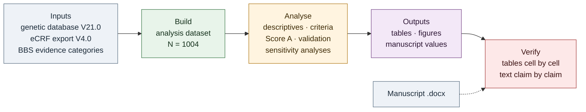
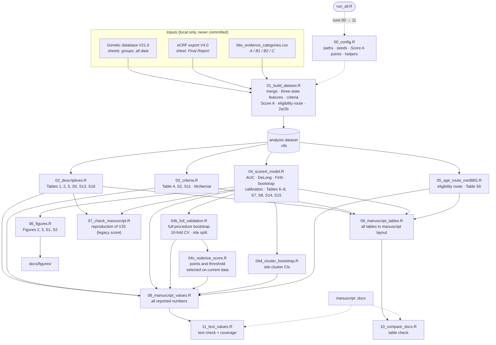
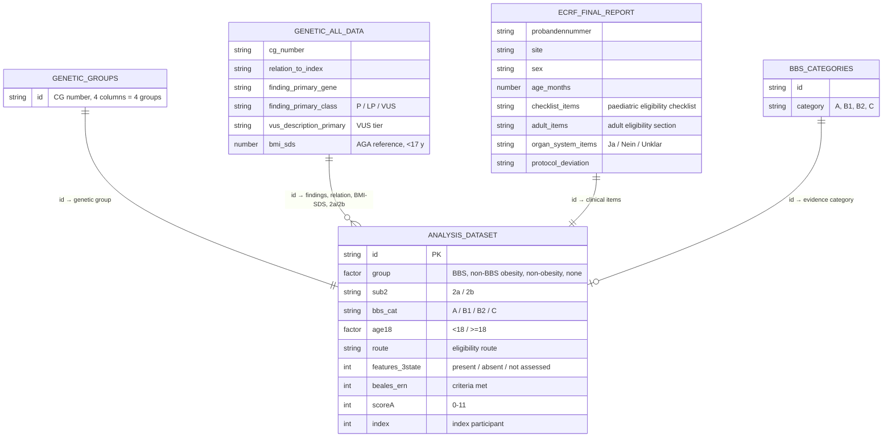
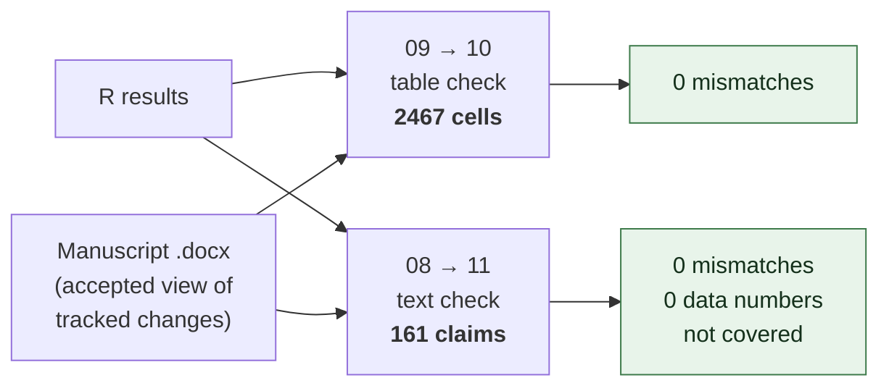
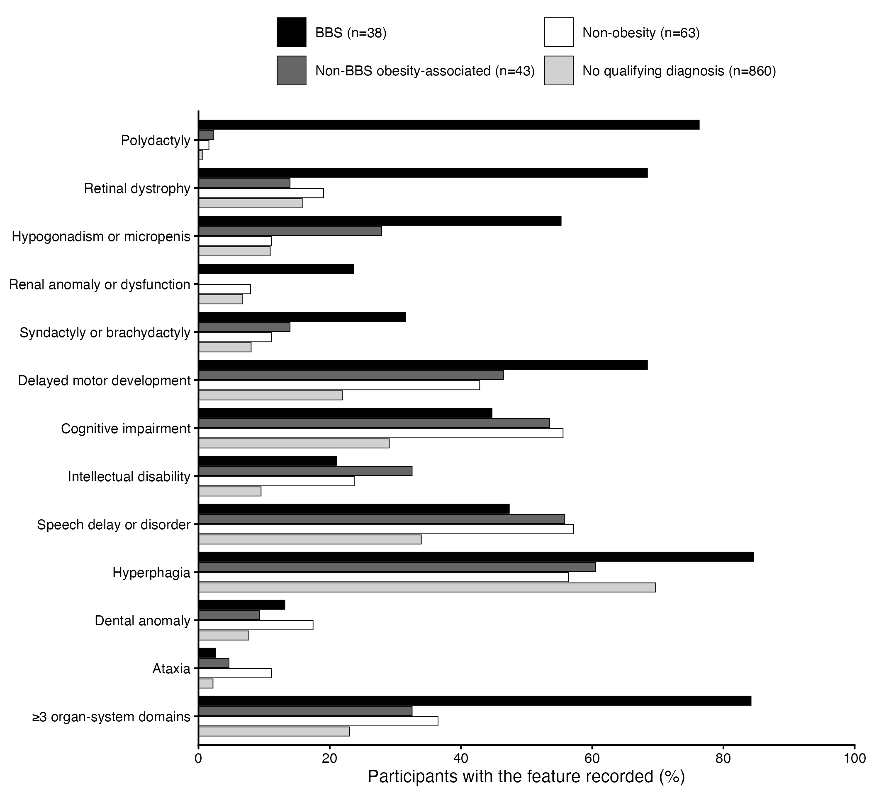
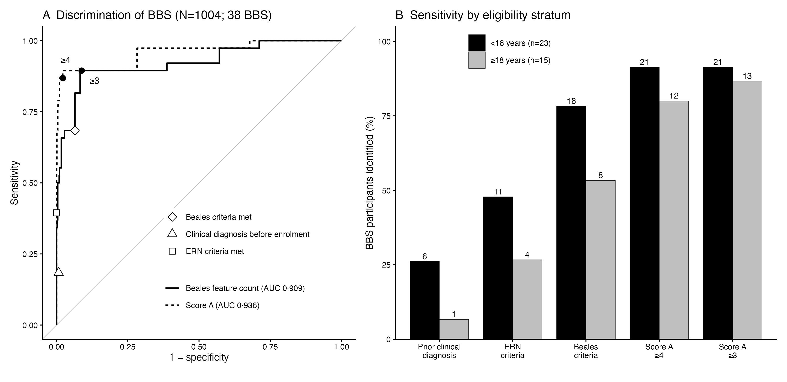
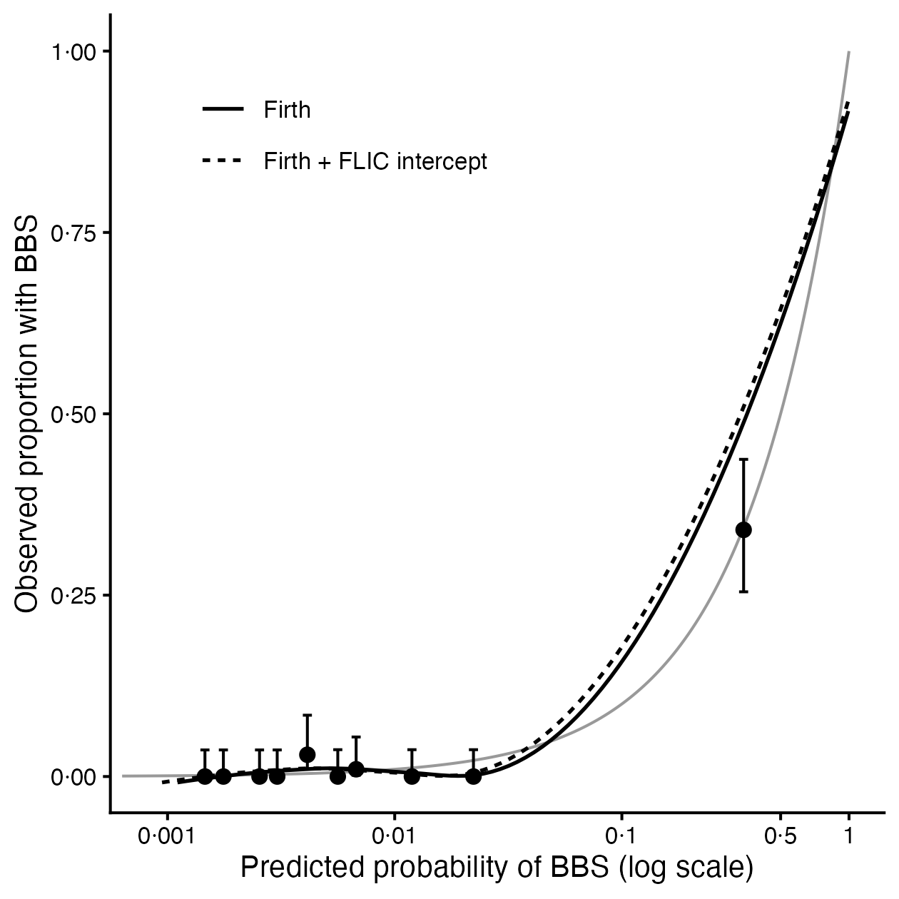
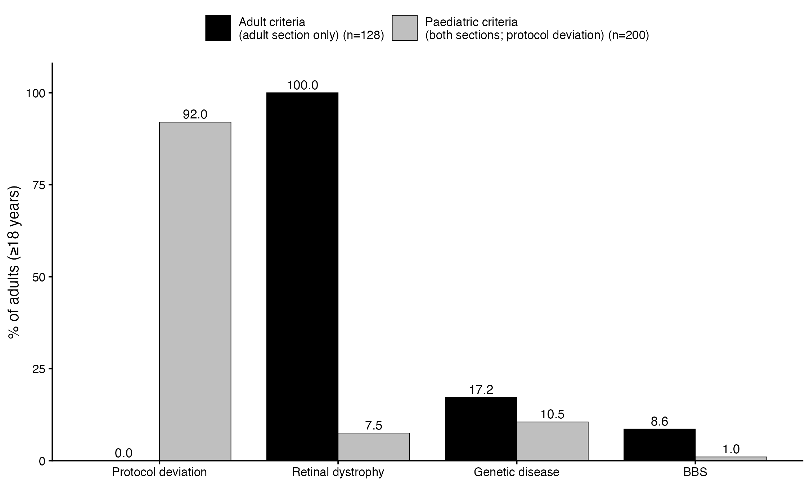

# WEGIO — reproducible statistical analysis in R


Analysis code for the **WEGIO** study (*Whole Genetic Approach in Early Genetic Identification of Obesity*), a multicentre cohort of 1004 participants with severe early-onset obesity or obesity with retinal disease who underwent exome sequencing with copy-number analysis.

The workflow takes the study's genetic database and electronic case-report form (eCRF) export and produces every data-derived result in the manuscript:

- frequency of genetic disease and of Bardet–Biedl syndrome (BBS)
- clinical profiles of the genetic groups
- performance of the Beales and ERN clinical criteria
- **Score A**, a six-item clinical score for BBS: derivation, internal validation, calibration and site-level robustness
- age-stratum, eligibility-route and other sensitivity analyses

It then **checks the manuscript against the data**, cell by cell for every table and claim by claim for every number in the text.

> **No data are included in this repository.** The input files contain pseudonymised participant-level data and are available only within the study team (see [Data protection](#data-protection)).

---

## Contents

1. [Pipeline at a glance](#pipeline-at-a-glance)
2. [Script-level workflow](#script-level-workflow)
3. [Data schema](#data-schema)
4. [Verification against the manuscript](#verification-against-the-manuscript)
5. [Results figures](#results-figures)
6. [Analysis decisions](#analysis-decisions)
7. [Repository structure](#repository-structure)
8. [Requirements and setup](#requirements-and-setup)
9. [Key definitions](#key-definitions)
10. [Statistical methods](#statistical-methods)
11. [Reproducibility notes](#reproducibility-notes)
12. [Data protection](#data-protection)
13. [Author and license](#author-and-license)

---

## Pipeline at a glance



One command runs everything (about 1 minute):

```bash
Rscript R_workflow_V25/run_all.R
```

---

## Script-level workflow



---

## Data schema

How the two source files become the analysis dataset (one row per participant):



Derived variables are documented in [Key definitions](#key-definitions).

---

## Verification against the manuscript



| Check | Script | What it does | Status (manuscript V25.2) |
|---|---|---|---|
| Tables | `09` → `10` | Rebuilds tables 1, 2, 4–8 and S2, S4–S8, S11, S13–S16 in the manuscript layout and compares every cell | 2467 cells, 0 mismatches |
| Text | `08` → `11` | Generates every numeric statement from the data and checks it appears verbatim; lists any number no claim accounts for | 161 claims, 0 mismatches, 0 uncovered data numbers |
| V25 reproduction | `07` | Reproduces 67 values of the earlier manuscript V25 (legacy Score A) | 59/67 match; differences documented |

Statements that rest on genetic classification inputs are checked for presence only: enrolment flow, gene and variant counts, secondary findings, the 2b disease categories and the nested diagnosis rules. Table 3, S1, S2b, S3, S10 and S12 are classifications or mappings and are not rebuilt.

To check another manuscript version:

```bash
MANUSCRIPT_DOCX="/path/to/manuscript.docx" Rscript R_workflow_V25/run_all.R
```

---

## Results figures

> Aggregate results of an unpublished manuscript. Keep the repository private until publication (see [Data protection](#data-protection)). The images are regenerated by `run_all.R`.

**Figure 2 — Clinical features by genetic group**



**Figure 3 — Score A, Beales criteria, ERN criteria, and clinical diagnosis before enrolment**



**Figure S1 — Calibration of the Firth model**



**Figure S2 — Adults by documented eligibility route**



---

## Analysis decisions

Decisions taken on statistical grounds during the re-analysis (November 2026). Each is implemented in the code and described in the manuscript.

| Topic | Decision |
|---|---|
| Genetic groups | V21.0 grouping (inheritance-specific diagnosis rule of 27 Oct 2026) |
| Missing clinical items | Not assessed = absent (primary); sensitivity analyses as present and complete case |
| Hyperphagia | Structurally missing without the paediatric checklist; all comparisons restricted to the 874 participants with it |
| Age strata | <18 / ≥18 years primary (eligibility differed at 18); <16 / ≥16 additional |
| Beales criteria | Syndactyly/brachydactyly as one secondary feature (Beales 1999) |
| Group comparisons | Fisher–Freeman–Halton exact test (no simulation); pairwise Fisher with Haldane–Anscombe OR and Benjamini–Hochberg correction |
| Firth model | Profile penalised-likelihood CIs and p values; FLIC for predicted probabilities |
| Score A | Points re-derived on the current data (5/2/1/1/1/1, max 11); threshold ≥4 by maximum optimism-corrected Youden index, ≥3 as rule-out |
| Validation | Bootstrap of the complete derivation procedure, 10-fold cross-validation, site-split validation, site-cluster bootstrap CIs |
| Quartiles | R type 7 (linear interpolation) |

---

## Repository structure

```
R_workflow_V25/
├── run_all.R                              # entry point: runs 00 → 11, refreshes docs/figures
├── WEGIO_V25_step_by_step_validation.Rmd  # step-by-step report, one decision per step (→ Word)
├── R/
│   ├── 00_config.R                        # paths, constants, seeds, Score A points, helpers
│   ├── 01_build_dataset.R                 # analysis dataset (N = 1004), derived variables, QC files
│   ├── 02_descriptives.R                  # tables 1, 2, 5, S5, S13, S16
│   ├── 03_criteria.R                      # table 4, S2, S11; exact McNemar
│   ├── 04_scoreA_model.R                  # discrimination, Firth model, bootstrap, calibration
│   ├── 04b_full_validation.R              # validation of the complete derivation procedure
│   ├── 04c_rederive_score.R               # points and threshold selected on the current data
│   ├── 04d_cluster_bootstrap.R            # site-cluster bootstrap CIs
│   ├── 05_age_route_nonBBS.R              # eligibility route, age contrasts, non-BBS model (S6)
│   ├── 06_figures.R                       # figures 2, 3, S1, S2
│   ├── 07_check_manuscript.R              # reproduction of manuscript V25 (legacy Score A)
│   ├── 08_manuscript_values.R             # all reported numbers -> output/manuscript_values.json
│   ├── 09_manuscript_tables.R             # all data-derived tables in manuscript layout
│   ├── 10_compare_docx.R                  # table check against the manuscript .docx
│   ├── 11_text_values.R                   # text check against the manuscript .docx, with coverage
│   └── read_docx_tables.R                 # reads .docx tables and paragraphs (accepted view)
├── config/
│   └── bbs_evidence_categories_TEMPLATE.csv
├── docs/
│   └── figures/                           # result figures shown in this README
├── .gitignore                             # excludes all data and outputs
└── README.md
```

---

## Requirements and setup

**Requirements**

- R ≥ 4.3 (developed on R 4.5.2, macOS)
- Packages: `readxl`, `dplyr`, `tidyr`, `stringr`, `purrr`, `logistf`, `pROC`, `binom`, `exact2x2`, `ggplot2`, `patchwork`, `writexl`, `xml2`, `jsonlite`. `run_all.R` installs any that are missing from CRAN.
- Optional, for the Word report: `rmarkdown` and pandoc (shipped with RStudio).
- A UTF-8 locale (set automatically in `00_config.R`).

**Setup**

1. Clone the repository into the folder that holds the input data, under the name `R_workflow_V25`:

   ```bash
   cd "/path/to/data-folder"
   git clone <repo-url> R_workflow_V25
   ```

2. Place the inputs in the data folder, the parent of `R_workflow_V25`:

   | File | Content |
   |---|---|
   | `WEGIO_all_genetic_results_20261104_V21.0_VSK.xlsx` | Genetic database V21.0 (4 Nov 2026) |
   | `eCRF_Wegio_Export_Sheet_20261101_V4.0_PBE.xlsx` | eCRF export V4.0 (1 Nov 2026) |
   | `bbs_evidence_categories.csv` | `id,category` (A, B1, B2, C) for the 38 participants with BBS; format as in `config/bbs_evidence_categories_TEMPLATE.csv` |
   | `WEGIO_manuscript_*.docx` | Manuscript to check (optional; set `MANUSCRIPT_DOCX`) |

3. Run from the data folder:

   ```bash
   Rscript R_workflow_V25/run_all.R
   ```

   To run from elsewhere, set `WEGIO_DIR` to the data folder. To produce the step-by-step report in Word:

   ```bash
   Rscript -e 'rmarkdown::render("R_workflow_V25/WEGIO_V25_step_by_step_validation.Rmd", knit_root_dir = getwd(), output_dir = "R_workflow_V25/output")'
   ```

   Outside RStudio, set `RSTUDIO_PANDOC` to RStudio's pandoc folder, for example `/Applications/RStudio.app/Contents/Resources/app/quarto/bin/tools/aarch64`.

**Outputs** (`R_workflow_V25/output/`, never committed)

| File | Content |
|---|---|
| `tables/0*_*.xlsx` | One workbook per analysis script, one sheet per table |
| `manuscript_tables.xlsx` | All tables in manuscript layout |
| `manuscript_values.json` | All reported numbers, formatted as in the manuscript |
| `tables/10_docx_vs_R_mismatches.xlsx` | Table check: summary, mismatches, all cells |
| `tables/11_text_check.xlsx` | Text check: claims and number coverage |
| `tables/check_*.xlsx` | Data-quality checks (VUS tiers, ages) |
| `figures/*.png` | Figures at 300 dpi |
| `sessionInfo.txt` | R and package versions |

---

## Key definitions

| Element | Implementation |
|---|---|
| Genetic groups | Taken unchanged from sheet `groups` of V21.0: BBS 38; non-BBS obesity-associated 43; non-obesity 63; no qualifying diagnosis 860 |
| Group 2 subgroups | 2a (obesity as a core feature): a P/LP primary finding in MC4R, LEPR or PHIP, or a deletion at 16p11.2, 6q15–q16 (incl. SIM1) or 17p11.2; 2b: all other group 2 diagnoses (23 / 20) |
| BBS evidence categories | A biallelic P/LP; B1 P/LP + VUS-high; B2 below the molecular rule, Beales or ERN met; C below the rule, neither met (local input file) |
| Clinical features | eCRF eligibility checklist and organ-system section combined (manuscript table S1); present if any item is "Ja" |
| Three-state handling | present / absent / not assessed ("Unklar" without any "Ja"). Primary analysis: not assessed = absent |
| Hyperphagia | Recorded only in the paediatric checklist: missing for 130 participants; comparisons use the 874 with the checklist. Feature/domain counts and the multivariable non-BBS model keep the primary coding (`hyperphagia_any`) |
| Age strata | <18 / ≥18 years primary; <16 / ≥16 additional; age from the eCRF (months) |
| Eligibility route | Adult section only / paediatric checklist + adult section / paediatric checklist only |
| Beales criteria | ≥4 primary, or 3 primary + ≥2 secondary features; syndactyly/brachydactyly one secondary feature |
| ERN criteria | Clinical items only: ≥4 primary, or 3 primary + 2 secondary |
| Score A | Polydactyly 5; retinal dystrophy 2; hypogonadism or micropenis, renal anomaly, syndactyly or brachydactyly, neurodevelopmental impairment 1 each (0–11); thresholds ≥4 and ≥3. The earlier version (0–13, ≥5) is kept as `scoreA_legacy` |

---

## Statistical methods

- **Proportions:** Wilson 95% CI.
- **Group comparisons:** Fisher–Freeman–Halton exact test (computed exactly) and Kruskal–Wallis.
- **Pairwise comparisons:** Fisher's exact test with Haldane–Anscombe odds ratios; Benjamini–Hochberg correction across 24 prespecified features within each comparison and across all 144 tests.
- **Discrimination:** AUC (Mann–Whitney) with a stratified bootstrap percentile CI (2000 resamples). Score A is compared with the ordinal Beales count by the DeLong test (`pROC`) and a bootstrap CI of the difference; the comparison is descriptive because Score A was derived in this cohort.
- **Firth model:** `logistf` with the seven prespecified items, age per 10 years and male sex. CIs and p values from the profile penalised likelihood. Integer points from rounded positive coefficients (≥1 point if β > 0·25). FLIC intercept correction for predicted probabilities.
- **Internal validation:**
  - Harrell bootstrap optimism (500 resamples) for the model and the score.
  - Bootstrap of the complete derivation procedure: points re-derived, sensitivity/specificity at the fixed thresholds and at a threshold re-chosen by Youden's index.
  - Repeated stratified 10-fold cross-validation (20 repeats).
  - Internal–external validation across sites: derivation at the two sites with most BBS cases, validation at the other 35.
- **Site clustering:** site-cluster bootstrap CIs (2000 resamples of 37 sites), because 31 of 38 BBS cases come from two sites.
- **Calibration:** deciles of predicted risk, loess-smoothed curves, calibration slope, calibration-in-the-large, Brier score.
- **Sensitivity analyses:**
  - reference standards: category A only, A + B1, A vs all others
  - populations: index participants, excluding the two high-BBS sites, leave-one-site-out, age strata, eligibility route
  - three-state handling: not assessed as present; complete case
  - retinal item removed
- **Predictive values at lower prevalence:** Bayes' theorem.

---

## Reproducibility notes

- All random procedures use `SEED_BOOT = 20261104` (`00_config.R`); bootstrap CIs are reproducible run to run. Group comparisons use exact tests, so they need no seed.
- `01_build_dataset.R` writes data-quality files: `check_BBS_VUS_tiers.xlsx` (evidence categories vs V21.0 VUS tiers and the V18.6 re-scoring) and `check_data_quality_age.xlsx` (missing or negative ages).
- `07_check_manuscript.R` documents the differences between this analysis and manuscript V25: Beales counting rule (88/62/46 vs 89/63/47), complete-case N (601 vs 619), bootstrap points in table S14, and Wald vs profile-likelihood CIs in table 6.
- `sessionInfo.txt` records the exact R and package versions of each run.

---

## Data protection

- The input workbooks, `bbs_evidence_categories.csv`, everything in `output/` (including `.rds` files) and review notes contain pseudonymised participant-level data. `.gitignore` excludes them; **do not force-add them.**
- `docs/figures/` contains aggregate figures only (no participant identifiers). Because they show unpublished results, keep the repository **private** until the manuscript is published, unless the consortium agrees otherwise.
- Before every push, check that no participant IDs are tracked:

  ```bash
  git grep -nE "CG0[0-9]{8}" || echo "no participant IDs in tracked files"
  ```

---

## Author and license

**Author:** Tanya Deniz Toluay Coşkun, Data Science and Artificial Intelligence Institute, Boğaziçi University

**License:** to be agreed by the WEGIO Consortium.
