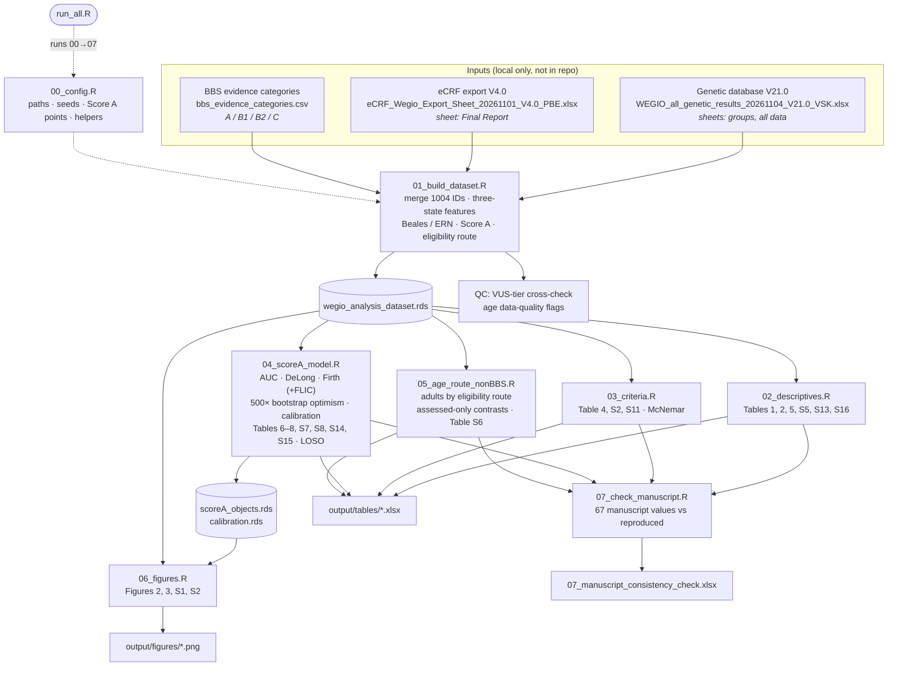

# WEGIO — reproducible analysis workflow (manuscript V25)

R workflow that reproduces the statistical analyses of the WEGIO manuscript V25 from the patient-level source data. WEGIO stands for Whole Genetic Approach in Early Genetic Identification of Obesity. The workflow covers:

- the frequency of genetic disease and of Bardet–Biedl syndrome (BBS)
- clinical profiles of the genetic groups
- the Beales and ERN clinical criteria
- Score A: Firth model, bootstrap internal validation, calibration and DeLong comparison
- site, index-only and age-stratum sensitivity analyses
- an automated consistency check of the reproduced values against the numbers reported in the manuscript

> **No data are included in this repository.** The input workbooks contain patient-level data and are available only within the study team (see [Data protection](#data-protection)).

---

## Workflow



---

## Repository structure

```
R_workflow_V25/
├── run_all.R                         # entry point: runs 00 → 07, writes sessionInfo.txt
├── R/
│   ├── 00_config.R                   # paths, constants, seeds, Score A points, helper functions
│   ├── 01_build_dataset.R            # analysis dataset (N = 1004)
│   ├── 02_descriptives.R             # tables 1, 2, 5, S5, S13, S16; adult ophthalmology
│   ├── 03_criteria.R                 # table 4, S2, S11; exact McNemar
│   ├── 04_scoreA_model.R             # discrimination, Firth model, validation, calibration
│   ├── 05_age_route_nonBBS.R         # eligibility route, age contrasts, non-BBS model (S6)
│   ├── 06_figures.R                  # figures 2, 3, S1, S2
│   └── 07_check_manuscript.R         # automated consistency check
├── config/
│   └── bbs_evidence_categories_TEMPLATE.csv
├── .gitignore                        # excludes all data and outputs
└── README.md
```

---

## Requirements

- R ≥ 4.3 (developed on R 4.5.2, macOS)
- Packages: `readxl`, `dplyr`, `tidyr`, `stringr`, `purrr`, `logistf`, `pROC`, `binom`, `exact2x2`, `ggplot2`, `patchwork`, `writexl`. `run_all.R` installs any that are missing from CRAN.
- A UTF-8 locale (set automatically in `00_config.R`, needed for eCRF labels such as "Weiß").

## Setup and run

1. Clone the repository **into the folder that holds the input data**, under the name `R_workflow_V25`:

   ```bash
   cd "/path/to/WEGIO new grouping"
   git clone <repo-url> R_workflow_V25
   ```

2. Place these files in the data folder, the parent of `R_workflow_V25`:

   | File | Source |
   |---|---|
   | `WEGIO_all_genetic_results_20261104_V21.0_VSK.xlsx` | Genetic database V21.0 (VSK, 4 Nov 2026) |
   | `eCRF_Wegio_Export_Sheet_20261101_V4.0_PBE.xlsx` | eCRF export V4.0 (PBE, 1 Nov 2026) |
   | `bbs_evidence_categories.csv` | Columns `id,category` (A, B1, B2, C) for the 38 BBS participants; format as in `config/bbs_evidence_categories_TEMPLATE.csv` |

3. Run the workflow from the data folder (about 20 seconds):

   ```bash
   Rscript R_workflow_V25/run_all.R
   ```

   To run from another location, set the environment variable `WEGIO_DIR` to the data folder.

4. Results are written to `R_workflow_V25/output/`:
   - `tables/*.xlsx`: one workbook per script, with one sheet per table
   - `figures/*.png`: 300 dpi
   - `tables/07_manuscript_consistency_check.xlsx`: manuscript value, reproduced value and match status
   - `sessionInfo.txt`: package versions

---

## Key definitions

| Element | Implementation |
|---|---|
| Genetic groups | Taken unchanged from sheet `groups` of V21.0 (BBS 38; non-BBS obesity-associated 43; non-obesity 63; no qualifying diagnosis 860), per the inheritance-specific diagnosis rule specified on 27 Oct 2026 |
| Clinical features | eCRF eligibility checklist and organ-system section combined (manuscript table S1); a feature is present if any item is "Ja" |
| Three-state handling | present / absent / not assessed ("Unklar" without any "Ja"). Primary analysis: not assessed = absent. Sensitivity analyses: not assessed = present; complete case |
| Age strata | Primary <18 / ≥18 years (eligibility differed at 18); additional <16 / ≥16 years; age from eCRF (months) |
| Eligibility route | Adult section only / paediatric checklist + adult section / paediatric checklist only, based on which eCRF sections were completed |
| Beales criteria | ≥4 primary, or 3 primary + ≥2 secondary features. Syndactyly/brachydactyly counts as **one** secondary feature (Beales 1999); the V25 variant that counts them separately is kept as `beales_v25` |
| ERN criteria | Clinical items only: ≥4 primary, or 3 primary + 2 secondary. Age and molecular components not operationalised |
| Score A | Polydactyly 5; retinal dystrophy, hypogonadism/micropenis, renal anomaly 2 each; syndactyly/brachydactyly, neurodevelopmental impairment 1 each (0–13) |

## Statistical methods

- **Proportions:** Wilson 95% CI. Group comparisons use a Monte Carlo exact test (5000 replicates) and Kruskal–Wallis; pairwise comparisons use Fisher's exact test with Benjamini–Hochberg correction (within comparison and across all 144 tests).
- **Discrimination:** AUC (Mann–Whitney) with a stratified bootstrap percentile CI (2000 resamples). Paired comparison of Score A vs the ordinal Beales count uses the DeLong test (`pROC`) and a bootstrap CI of the difference.
- **Firth model:** `logistf` with the seven candidate items, age per 10 years and male sex. CIs and p values from the profile penalised likelihood; Wald CIs are also reported. Integer points are re-derived by rounding positive coefficients (≥1 point if β > 0·25). FLIC intercept correction is used for predicted probabilities.
- **Internal validation:** Harrell bootstrap optimism (500 resamples, seed 20261104), applied to the full model and the re-derived integer score. Reports corrected AUC, calibration slope and Brier score, plus the bootstrap distribution of points per item.
- **Calibration:** deciles of predicted risk (as in V25) and a smoothed loess curve; calibration-in-the-large for Firth vs FLIC.
- **Sensitivity analyses:**
  - reference standards: category A only, A + B1, and A vs all others
  - populations: index participants only, excluding the two sites with most BBS cases, leave-one-site-out, age strata, eligibility route
  - Score A variants: retinal item removed; three-state handling of missing features
- **Predictive values at lower prevalence:** Bayes' theorem.

## Reproducibility notes

- All random procedures use `SEED_BOOT = 20261104` (`00_config.R`). Monte Carlo p values and bootstrap CIs can differ slightly from the Python analysis used for V25.
- `07_check_manuscript.R` lists every manuscript value that is not reproduced. Known differences for V25:
  - Beales counts outside BBS (88/62/46 vs 89/63/47; counting rule)
  - complete-case N (601 vs 619)
  - bootstrap median points in table S14
  - Wald vs profile-likelihood CIs in table 6
- `01_build_dataset.R` writes two QC files:
  - `check_BBS_VUS_tiers.xlsx`: compares the evidence categories with the V21.0 VUS tiers (column J) and the ARO V18.6 re-scoring
  - `check_data_quality_age.xlsx`: missing or negative ages

## Data protection

- The workbooks, `bbs_evidence_categories.csv`, everything in `output/` (including `.rds` files) and review notes contain pseudonymised participant-level data. `.gitignore` excludes them; **do not force-add them.**
- Before pushing, check that no participant IDs are tracked:

  ```bash
  git grep -nE "CG0[0-9]{8}" || echo "no participant IDs in tracked files"
  ```

- Keep the repository **private** unless the consortium agrees otherwise. Analysis code is shared on reasonable request after publication (manuscript data-sharing statement).

## Author

Tanya Deniz Toluay Coşkun, Data Science and Artificial Intelligence Institute, Boğaziçi University

## License

[To be agreed by the WEGIO Consortium.]
